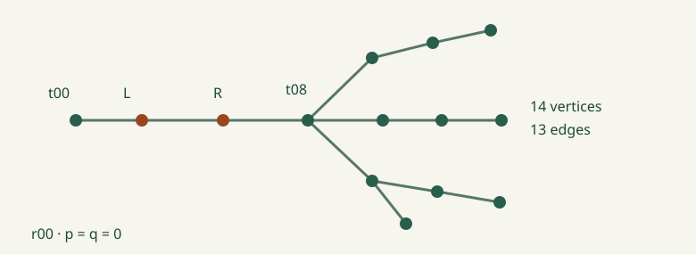
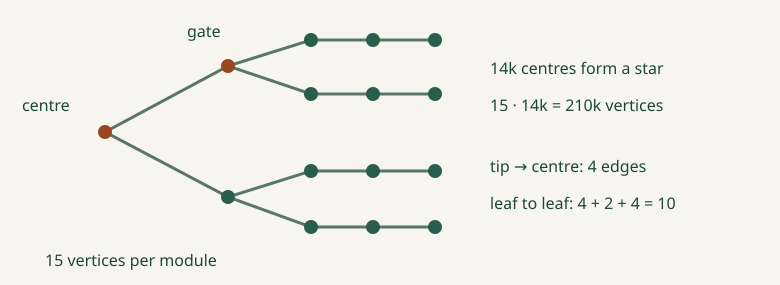

# Evidence map

[Project home](README.md) · [简体中文](EVIDENCE_MAP.zh-Hans.md) · [Python and certificates](REPRODUCE.md)

The links below use the PDF page numbers of the 72-page public reading edition. The results concern the ordinary game with no vertices covered at the start. [Full paper](manuscript/Isolation_Game_Research_Report.pdf) · [Lean sources and build instructions](formal/README.md)

| Result | Where to read or test |
|---|---|
| D6 and D7 establish the unrounded Dominator-start bound for trees of order at least 3 in their respective diameter ranges. | [Statement and literature crosswalk](manuscript/SOURCES.md) |
| D8 has a 23-vertex counterexample to the unrounded bound. | [Exact figure](assets/d8-one-leaf.svg) · [Python replay](REPRODUCE.md) |
| Through diameter 9, Dominator can finish within $\lceil3n/7\rceil$ moves when starting. | [Theorem 0.1](manuscript/Isolation_Game_Research_Report.pdf#page=4) · [Chapter 12](manuscript/Isolation_Game_Research_Report.pdf#page=54) · [Lean entry](formal/D9/FourteenDiameterNineClosure.lean) |
| At diameter 10, both starters can exceed the ceiling for infinitely many orders. | [Appendix B](manuscript/Isolation_Game_Research_Report.pdf#page=59) · [Zoomable construction](demo/d10.html) · [Lean entry](formal/D10/FinalDiameterCounterexample.lean) |

## A concrete D9 proof case

The proof reduces a minimum-order counterexample to 14 candidate families. Each family still allows arbitrary numbers of ordinary branches. In family `r00`, two adjacent centers carry a one-vertex `t00` branch and an eleven-vertex `t08` branch. When $p=q=0$, the tree has 14 vertices. Adding $p$ and $q$ ordinary seven-vertex branches gives $14+7(p+q)$ vertices. The `r00` budget is $6+3(p+q)$ moves, equal to the target ceiling. [Chapter 12 budget table](manuscript/Isolation_Game_Research_Report.pdf#page=55)

## The diameter-10 family

Each module joins the midpoints of two disjoint seven-vertex paths to one shared center. Joining the centers of $14k$ modules into a star gives $210k$ vertices. A path between the farthest tips in distinct leaf modules uses $4+2+4=10$ edges. Appendix B proves a lower bound of $91k$ moves for either starter, against the ceiling $90k$.

[Change the parameter or zoom the diagram](demo/d10.html)

