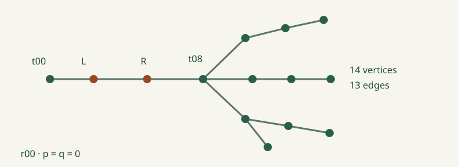
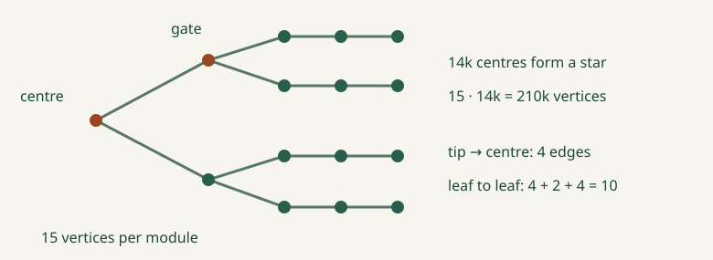

# 证据与证明导航

[中文首页](README.zh-Hans.md) · [English](EVIDENCE_MAP.md) · [复算指南](REPRODUCE.zh-Hans.md)

下列链接中的页码对应公开阅读版 PDF 的 72 页。以下结果均针对初始时没有顶点被覆盖的普通博弈。[完整论文](manuscript/Isolation_Game_Research_Report.pdf) · [Lean 源码与构建说明](formal/README.zh-Hans.md)

| 结果 | 阅读与核验入口 |
|---|---|
| D6 和 D7 在各自的直径范围内，证明了至少有 3 个顶点的树满足 Dominator 先手的不取整 $3n/7$ 上界。 | [定理与文献对照](manuscript/SOURCES.zh-Hans.md) |
| D8 给出一棵 23 点树，反驳不取整的上界。 | [精确构造图](assets/d8-one-leaf.svg) · [Python 复算](REPRODUCE.zh-Hans.md) |
| 直径至多为 9 时，Dominator 先手可在 $\lceil3n/7\rceil$ 手内结束。 | [定理 0.1](manuscript/Isolation_Game_Research_Report.pdf#page=4) · [第 12 章](manuscript/Isolation_Game_Research_Report.pdf#page=54) · [Lean 定理入口](formal/D9/FourteenDiameterNineClosure.lean) |
| 直径为 10 时，存在无限多个规模，使两种先手的最优手数都超过上取整界。 | [附录 B](manuscript/Isolation_Game_Research_Report.pdf#page=59) · [可缩放构造](demo/d10.html) · [Lean 定理入口](formal/D10/FinalDiameterCounterexample.lean) |

## D9 证明中的一个具体例子

证明将顶点数最少的反例归约到 14 个候选族。每一族仍允许任意多条普通分支。在 `r00` 族中，两个相邻的中心分别连接一个 1 点的 `t00` 分支和一个 11 点的 `t08` 分支。$p=q=0$ 时，这棵树有 14 个顶点；再接入 $p$ 条和 $q$ 条七点普通分支，顶点总数为 $14+7(p+q)$。该族的手数预算为 $6+3(p+q)$，恰好等于目标上取整界。有限证书处理局部策略和结构分类，一般证明则处理任意多条普通分支。[第 12 章逐族预算表](manuscript/Isolation_Game_Research_Report.pdf#page=55)

## 直径 10 的反例族

每个模块将两条互不相交的七点路径的中点连接到同一个中心。把 $14k$ 个模块的中心连成星形，可得到 $210k$ 个顶点。不同外围模块中最远端点之间的路径由 $4+2+4=10$ 条边组成。附录 B 证明，两种先手下都至少需要 $91k$ 手，而上取整基准是 $90k$。

[调整参数或缩放构造图](demo/d10.html)

