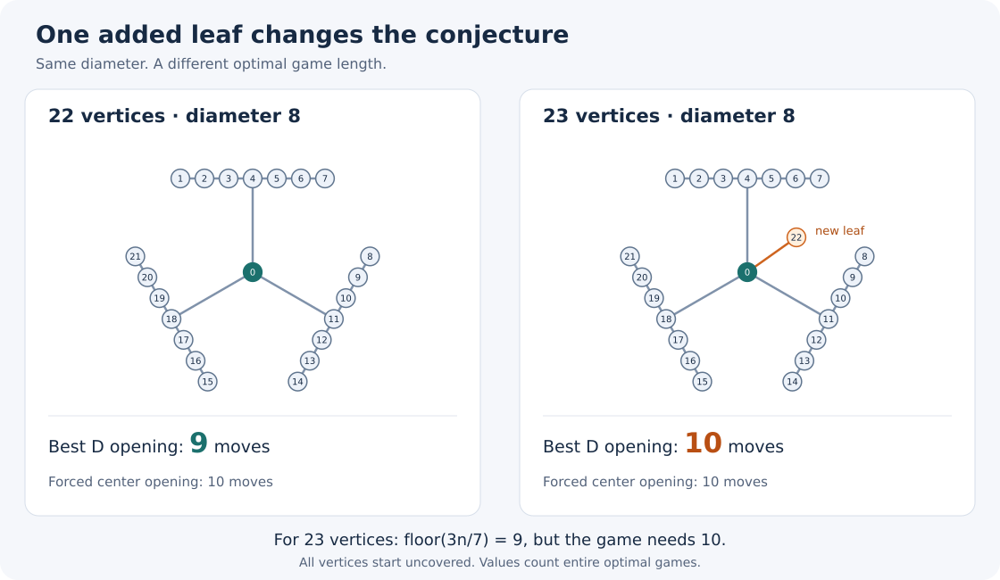
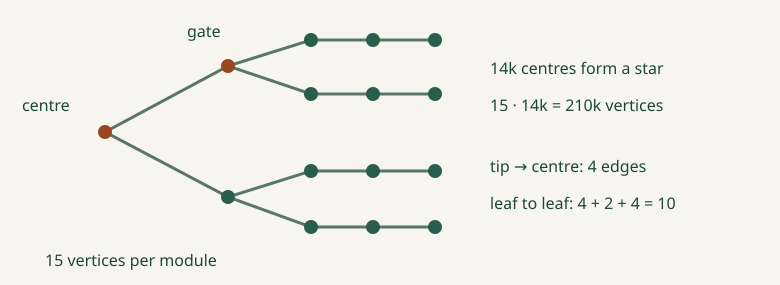

# How AI worked through the isolation game on trees

[简体中文](RESEARCH.zh-Hans.md) · [Project home](README.md) · [Full paper](manuscript/Isolation_Game_Research_Report.pdf) · [Lean sources](formal/README.md)

One leaf changed the question. The initial goal was to show that, on a tree of order $n\ge3$, Dominator could finish in at most $\lfloor3n/7\rfloor$ moves when starting. AI added a leaf to a diameter-8 tree: its diameter stayed the same, but its optimal value exceeded the proposed bound. The next question was how far a ceiling bound could extend.

The resulting threshold is **diameter 9 versus diameter 10**: the ceiling bound holds for Dominator starts on all finite trees of diameter at most 9, while an infinite diameter-10 family exceeds it for either starter. This account follows surviving 2026 research exchanges, revisions and verification records. The exchanges are paraphrased.

## Try a game

Two players take turns choosing a vertex, covering it and its neighbors. A legal move must newly cover an endpoint of an edge whose endpoints were both uncovered before the move. The game ends when no such edge remains. Dominator tries to finish quickly; Staller tries to prolong play.

On the five-vertex path, choose vertex 2 first. Only edge 4—5 still has both endpoints uncovered. The already covered vertex 3 can be played next because it newly covers vertex 4. **Being covered and having been chosen are different states.** Confusing them can omit legal moves when reducing a position. [Try these moves](https://prooflog553.github.io/isolation-game-on-trees-exhibit/demo/index.html)

## 1. A nine-vertex path rules out a natural opening

A tree center minimizes the greatest distance to another vertex, so opening there looks natural. Surviving records from 11 September already identify exceptions. On 13 September, the human asked AI to seek counterexamples first, specifically whether a forced center opening could cost an extra move.

AI gave the nine-vertex path. Number its vertices 1 to 9 from left to right. If Dominator opens at the center, 5, Staller can choose 4, leaving unprocessed edges far apart at the two ends. One further move cannot handle both ends. With the first move fixed at 5 and optimal continuation, the game takes four moves; with a free opening, Dominator can choose 2 or 3 and finish in three.

The values for the nine fixed openings are **4, 3, 3, 4, 4, 4, 3, 3, 4**. This ruled out a proof based on always opening at the center; it did not disprove the three-move bound on this path. The remaining task was to explain how to find a sufficiently good opening on every tree in scope. [Compare vertices 5 and 2](https://prooflog553.github.io/isolation-game-on-trees-exhibit/demo/index.html) · [Replay all nine openings](ai-cases/check_ai_case_p9_d8.py)

## 2. One leaf changes the research question

On 29 September, the human asked AI to challenge two local lemmas and then examine leaves close to the center. AI reported that the lemmas survived under their stated conditions, but found a counterexample to the original bound.

Join the midpoints of three disjoint seven-vertex paths to a new common center. The resulting tree has 22 vertices and diameter 8. Attach one leaf to that center. The diameter remains 8, but the optimal value changes.

| Tree | Vertices | Diameter | Free D opening | Forced center opening |
|---|---:|---:|---:|---:|
| Three seven-vertex paths joined to a new center | 22 | 8 | 9 | 10 |
| One leaf added at the center | 23 | 8 | 10 | 10 |

For 23 vertices, $\lfloor3n/7\rfloor=9$, yet even Dominator's best opening takes 10 moves. AI proposed replacing the floor with $\lceil3n/7\rceil$; the human agreed on 30 September. The new bound equals 10 on this tree. The work then pursued two questions: which diameter ranges guarantee the new bound, and where does it first fail?

The public Python script enumerates legal moves from the edge lists, minimizing on Dominator's turn and maximizing on Staller's. It checks both trees and their forced center openings. [Reproduction guide](REPRODUCE.md) · [Exact solver](ai-cases/check_ai_case_p9_d8.py)

## 3. From diameter 12 to diameter 10

A 30 September record already describes a diameter-12 construction using 23-vertex modules. When joining two modules, the surviving report lists 21 connection classes: 10 completed and 11 reached time or state limits and remained unresolved. These counts come from that historical report.

After the human approved further exploration, the earliest recovered D10 construction used 15-vertex modules instead. Each has a center connected to the midpoints of two seven-vertex paths. Join the existing centers of $m\ge3$ modules in a star. Only edges are added, giving $15m$ vertices. A longest path between two leaf modules uses $4+2+4=10$ edges.

The proof then has to establish a long enough game. Staller's prescribed response is to choose the center of the module Dominator has just entered if that center has not yet been chosen. Otherwise, while unchosen centers remain, she chooses one of them. If Staller starts, she first chooses a center and then uses the same rule. A newly entered module has two seven-vertex paths; one Dominator move can affect at most one, leaving an edge that makes the center response legal.

After all centers have been chosen, the proof analyzes the remaining path branches. Combining the moves already made with the residual game gives at least $6m+\lfloor m/2\rfloor$ moves for a D start and $6m+\lceil m/2\rceil$ for an S start. Set $m=14k$: both bounds become $91k$ on $210k$ vertices, versus a ceiling of $90k$. The excess is at least linear in $k$.

The early surviving reply gave a D-start lower bound; the completed proof covers both starters. At the time of the construction, the general D9 upper bound remained open. [Interactive construction](https://prooflog553.github.io/isolation-game-on-trees-exhibit/demo/d10.html) · [Appendix B](manuscript/Isolation_Game_Research_Report.pdf#page=59) · [D10 Lean theorem](formal/D10/FinalDiameterCounterexample.lean)

## 4. Why the D9 candidate proof needed revision

For diameter 9, one tempting approach was to solve a smaller graph and add ordinary branches back one at a time. Each branch adds seven vertices and increases the target ceiling by three moves. Does adding such a branch always increase the optimal game length by at most three?

A 30 September record gives an exact counterexample to that local rule. The initial position is a forest of two disjoint trees with both centers premarked as covered. One center has one seven-vertex path, the other has two. Adding a path to the first center makes the two trees identical.

| Premarked position | Vertices | D starts | S starts |
|---|---:|---:|---:|
| One path on the first component, two on the second | 23 | 9 | 10 |
| Two paths on each component | 30 | 13 | 13 |

The D-start value rises by four. The three-move rule therefore needs structural conditions. This example concerns a local rule for premarked forests; the D9 theorem concerns an initially uncovered connected tree. [Replay the positions](ai-cases/check_ai_case_d9.py)

The human then requested adversarial review of the candidate proof. The first review called for major revision: some leaves of the finite certificates still required mathematical rules that had not been fully proved, and calculations for ten and eleven branches could not simply be generalized to arbitrarily many. The revision needed to specify when the three-move rules apply, how their budgets are counted and which conditions persist under repetition.

## 5. From finite checks to a general proof

The final proof connects finite computation and general strategies in four steps.

1. **Assume a counterexample of minimum order.** If a suitable part can be removed, one can handle it and invoke the bound for a smaller tree, contradicting minimality. After excluding many shapes, a minimum counterexample must be representable by two adjacent centers and their branches.
2. **Limit exceptional branches.** Local branches fall into 20 types. Vertex counts and move budgets bound the number of exceptional branches by three. A finite classification checks this structure, leaving 14 candidate families.
3. **Handle arbitrarily many ordinary branches in each family.** Let $p$ and $q$ be the numbers on the two sides. The strategy must respond to actual legal moves and account for boundary vertices that remain playable during induction. In family `r00`, there are $14+7(p+q)$ vertices and the strategy uses at most $6+3(p+q)$ moves, exactly the target ceiling, for all nonnegative $p,q$.
4. **Exclude all candidate families.** The 14 families meet the bound, ruling out the assumed minimum counterexample.

The revision supplied conditions for local rules and strategies that work as branch counts grow without bound. [Illustrated proof map](EVIDENCE_MAP.md) · [Family budgets on page 55](manuscript/Isolation_Game_Research_Report.pdf#page=55) · [D9 Lean source](formal/D9/FourteenDiameterNineClosure.lean)

## A Lean correction: which root was marked?

A parallel D7 investigation recorded a concrete correction. After an opening on a 16-vertex tree, the residual game corresponds to an 11-vertex auxiliary graph with adjacent roots $x$ and $y$. Root $x$ has one arm and $y$ has two; deleting them leaves different paths. The covered root in the reduced original position is the one with a single arm, so it corresponds to $x$.

The human clarified the correspondence and limited the scope of the correction; AI revised the local argument. The final formalization verifies that the residual game equals the auxiliary position with $x$ marked, and takes at most five further moves. Including the opening gives at most six.

A separate issue remained: an early Lean version assumed the small-order bound. Even a successful build of that version established only a conditional implication. A later version proved the small-order cases within the project and supplied them to obtain the final D7 theorem. One revision corrected the position; the other discharged an assumption. [D7 source](formal/D7-L3.zip) · [Lean build and theorem checks](formal/README.md)

## What the final results establish

The D9 upper bound and D10 infinite family identify diameter 10 as the first failure of the rounded D-start bound. The upper bound concerns ordinary D-start play; the counterexample supplies separate lower bounds for both starters. The assumptions are listed in the [theorem crosswalk](manuscript/SOURCES.md).

The human set the questions, chose priorities and approved a change in target when the evidence warranted it. AI proposed strategies and constructions, wrote proofs and code, and performed an adversarial review in another round. The board and Python check specific optimal values, finite certificates check reduced structures, and the paper and Lean supply general results. The origin of the earliest center-opening idea, any earlier D10 draft and the full search sequence remain incomplete in the surviving record. [Start with the replays](REPRODUCE.md) · [Published reproduction materials](https://github.com/prooflog553/isolation-game-on-trees-exhibit/releases/tag/v1.0.0)
