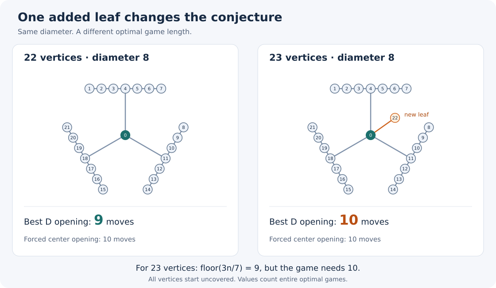
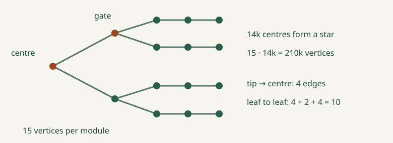

# AI 如何解开树上的隔离博弈

[English](RESEARCH.md) · [中文首页](README.zh-Hans.md) · [完整论文](manuscript/Isolation_Game_Research_Report.pdf) · [Lean 源码](formal/README.zh-Hans.md)

一片叶子改变了整个问题。研究最初想证明，在一棵有 $n$ 个顶点（$n\ge3$）的树上，Dominator 先手至多用 $\lfloor3n/7\rfloor$ 手就能结束博弈。AI 给一棵直径为 8 的树添了一片叶子，直径没变，最优手数却超过了原来的界。研究于是改问：把下取整换成上取整，这个新上界究竟能保证到多大的直径？

最后确定的分界是 **直径 9 成立，直径 10 开始失效**。Dominator 先手时，直径至多 9 的所有有限树都满足上取整界。直径 10 有一个无限反例族，在两种先手下都超过这条界。下面按留存的研究轮次、修订稿和核验文件讲述这个过程。日期沿用 2026 年的研究记录，对话采用转述。

## 先玩一局

两人轮流选顶点。每走一手，所选顶点和它的邻点都会被覆盖。合法的一手必须新覆盖一条原本两端均未覆盖的边的至少一个端点。当这样的边全部消失时，游戏便结束。Dominator 想尽快结束，Staller 想尽量拖长。

在五点路径上，先选第 2 点。这时只有 4—5 这条边的两端都还未覆盖。接下来仍可以选已经覆盖的第 3 点，因为它能新覆盖第 4 点。这个细节在后续研究中反复出现，非常重要。**已经被覆盖和已经被选过是两种不同的状态。** 把它们混在一起，就可能在化简余局时漏掉合法着法。[到棋盘试这两手](https://prooflog553.github.io/isolation-game-on-trees-exhibit/demo/index.html)

## 1. 九点路径，先淘汰一条看似自然的策略

树的中心到最远顶点的距离最短，因此先选中心看起来很自然。9 月 11 日的留存记录已经指出中心首着有例外。9 月 13 日，人要求 AI 优先找反例，专门检查固定从中心开始会不会比最优开局多走一手。

AI 给出了一条九点路径。把顶点从左到右编号为 1 到 9。Dominator 先选中心 5，Staller 可以接着选 4，使尚未处理的边留在相距较远的两端。下一手无法同时处理两端。把第一手固定在 5，双方随后都按最优策略走，整局要 4 手。如果让 Dominator 自己决定首着，选 2 或 3 就能在 3 手内结束。

九种固定首着的结果依次为 **4、3、3、4、4、4、3、3、4**。这排除了把中心首着作为通用策略的证明路线；3 手上界在这条路径上仍然成立。接下来的任务是解释每棵树怎样选到足够好的开局。[在线棋盘选 P9，比较顶点 5 和 2](https://prooflog553.github.io/isolation-game-on-trees-exhibit/demo/index.html) · [复算全部九种首着](ai-cases/check_ai_case_p9_d8.py)

## 2. 一片叶子让研究必须改题

9 月 29 日，人要求先找两条局部引理的漏洞，再检查离中心很近的叶子。AI 报告两条引理在原有条件下仍然成立，检查叶子时却找到了一个足以推翻原上界的反例。

取三条互不相交的七点路径，把三条路径的中点都接到一个新的共同中心。这棵树有 22 个顶点，最远端点之间相隔 8 条边。给共同中心再接一片叶子，最远距离仍是 8，最优手数却变了。

| 树 | 顶点数 | 直径 | D 自由选择首着 | 固定从中心首着 |
|---|---:|---:|---:|---:|
| 三条七点路径共用一个新中心 | 22 | 8 | 9 | 10 |
| 在中心添一片叶子 | 23 | 8 | 10 | 10 |

23 点时，$\lfloor3n/7\rfloor=9$，可 Dominator 选最好的第一手也需要 10 手。AI 提议把目标改为 $\lceil3n/7\rceil$，人于 9 月 30 日同意。新界在这棵树上恰好等于 10。研究随后沿两条线展开：一条是证明哪些直径范围内的树一定满足新界，另一条是寻找最早突破新界的直径。

公开的 Python 脚本从树的边表出发，枚举每个局面的合法走法。轮到 Dominator 就取最小值，轮到 Staller 就取最大值。读者能独立求出添叶前后的结果，也能复核首着固定在中心时的手数。[Python 复算说明](REPRODUCE.zh-Hans.md) · [精确求值脚本](ai-cases/check_ai_case_p9_d8.py)

## 3. 怎样把反例从直径 12 缩到直径 10

9 月 30 日的记录里，AI 已经用 23 点模块给出了直径 12 的构造。把两个模块接起来时，可以选不同的连接位置。留存回复记下了 21 类试验，其中 10 类算完，另有 11 类到达时间或状态上限，当时仍待解决。这个数字来自留存的阶段报告。

人同意继续探索后，AI 在目前找到的最早 D10 构造回复里换用了 15 点模块。每个模块有一个中心和两条七点路径，两条路径分别把中点接到中心。取 $m\ge3$ 个模块，用星形把已有的中心连起来。连接只增加边，所以这棵树共有 $15m$ 个顶点。从一个外围模块的最远端点走到另一个外围模块的最远端点，依次走 4、2、4 条边，给出直径 10。

缩短直径只是第一步。接下来要证明，这棵树确实能让对局持续足够久。证明首先为 Staller 给出一条应手规则。若 Dominator 刚在一个模块里走了一手，而这个模块的中心还没被选过，Staller 就选该中心。其余情况下，只要还有未被选过的中心，她就任选一个。若由 Staller 先手，她先选一个中心，之后用同一条规则。新进入的模块里有两条七点路径，Dominator 一手至多影响其中一条，另一条仍留有能保证该中心应手合法的边。

等所有模块的中心都被选过，证明再分析剩下的路径分支。把已经走过的手数和余局所需手数合起来，D 先手至少需要 $6m+\lfloor m/2\rfloor$ 手，S 先手至少需要 $6m+\lceil m/2\rceil$ 手。取 $m=14k$，两个下界都变成 $91k$。此时树有 $210k$ 个顶点，上取整基准为 $90k$，超出的手数至少随 $k$ 线性增长。

现存的早期回复给出了 D 先手下界。后来完成的证明覆盖了两种先手。这个构造出现时，D9 的一般上界还没证明。研究已经把能找到反例的直径降到了 10，还需要证明界在直径 9 一定成立。[在线改变模块数量](https://prooflog553.github.io/isolation-game-on-trees-exhibit/demo/d10.html) · [论文附录 B](manuscript/Isolation_Game_Research_Report.pdf#page=59) · [D10 Lean 主定理](formal/D10/FinalDiameterCounterexample.lean)

## 4. 为什么 D9 的候选证明被打回

到直径 9，一个诱人的办法是先解决小图，再逐条接回普通分支。每条普通分支有 7 个顶点，目标上界随之增加 3 手。研究据此提出一个问题：添一条七点分支，最优对局是否也至多延长三手？

9 月 30 日的研究轮留下了一个精确的反例。原局面由两棵互不相连的树组成，两个中心都预先标记为已覆盖。其中一个中心连一条七点路径，另一个中心连两条。再给第一个中心添一条七点路径，就得到两棵相同的树。

| 预标记局面 | 顶点数 | D 先手 | S 先手 |
|---|---:|---:|---:|
| 第一块一条路径，第二块两条路径 | 23 | 9 | 10 |
| 两块各有两条路径 | 30 | 13 | 13 |

D 先手从 9 变成 13，多了 4 手。这说明使用三手规则时必须检查结构条件。这个例子针对预标记森林的局部规则，而 D9 主定理针对从全未覆盖状态开始的一棵连通树；两种对象在证明中承担不同的任务。[复算这两个局面](ai-cases/check_ai_case_d9.py)

随后，人要求 AI 对候选稿做对抗性审稿。第一轮审稿要求大修，指出了两处具体缺口。第一，证书列到末尾的某些局面仍需用数学规则判断，稿件却没有把那些规则证全。第二，即使程序算过十条分支和十一条分支，也没有理由直接推广到任意多条。修订必须交代哪些局面可以用三手处理、手数怎样计入，以及重复这些步骤时哪些条件仍然成立。

## 5. 怎样从有限检查走到一般证明

最终的证明分四步把有限计算和一般策略接了起来。

1. **假如有反例，选顶点最少的一棵。** 如果从这棵树中能安全削去一部分，就可以先处理那一部分，再调用更小树的上界，与最小性的假设冲突。借此排除许多形状后，最小反例必须能用两个相邻的中心和它们的分支来表示。
2. **限制特殊分支。** 局部分支归到 20 种类型。再用顶点数和手数预算证明，特殊分支至多三个。有限分类检查这部分结构，最后留下 14 个候选族。
3. **逐族处理任意多普通分支。** 左右普通分支的数量仍可任意增长，分别记作 $p$ 和 $q$。证明需要为实际合法着法给出回应，也要在归纳时处理边界顶点仍可落子的情况。以 r00 族为例，树有 $14+7(p+q)$ 个顶点，策略保证最多 $6+3(p+q)$ 手，正好等于上取整界。这一步覆盖每一对非负整数 $p,q$。
4. **排除全部候选族。** 14 族都能满足上界，假设中的最小反例就被排除了。一般定理由此成立。

审稿改变的是有限证书与一般证明之间的连接。修订补齐了局部规则的适用条件，也给出了分支数任意增长时可以逐步执行的策略。读者可以先看 r00 一行怎样算出常数，再看整张表怎样覆盖 14 族。[带图的证明导航](EVIDENCE_MAP.zh-Hans.md) · [第 55 页的逐族预算表](manuscript/Isolation_Game_Research_Report.pdf#page=55) · [D9 Lean 主证明](formal/D9/FourteenDiameterNineClosure.lean)

## 一次 Lean 纠错，从标记哪个根说起

直径 7 的并行研究留下一处很具体的纠错。一棵 16 点树走完首着后，余局要对应到一张 11 点的辅助图。这张图有两个相邻的根 $x$ 和 $y$。$x$ 连一条臂，$y$ 连两条臂，删掉它们会留下不同的路径。原局面化简后，已经被覆盖的恰好是只连一条臂的那个根，因此对应的是 $x$。

人明确了对应关系并限定这次修改的范围，AI 修订了局部论证。最终的形式化验证表明，原图首着后的余局与辅助图中标记 $x$ 的状态等值，余局至多需要五手。加上已经走过的第一手，原树至多六手。

当时还有另一项工作：早期 Lean 版本假设顶点数较少的树已经满足上界。这样的版本即使编译成功，也只证明了带此前提的推论。后来的版本在工程内部证明这些小规模情形，再把结论代入，才得到最终的 D7 定理。一项修订校正了局面，另一项补足了前提。[D7 工程源码](formal/D7-L3.zip) · [Lean 构建与定理核验](formal/README.zh-Hans.md)

## 最终结果怎样落定

D9 的一般上界和 D10 的无限反例合起来，确定了上取整界第一次失效的直径是 10。上界针对普通 D 先手博弈，反例则给出两种先手各自的下界。每项结论的前提都列在[定理对照表](manuscript/SOURCES.zh-Hans.md)里。

人设定问题，决定先查哪些地方，也在证据改变时批准改题。AI 提出候选策略和构造，写出证明与程序，也在另一轮中承担对抗性审稿。棋盘和 Python 可以查清具体局面的最优值，有限证书可以核验经过归约的结构，论文和 Lean 则给出一般结论。早期中心首着想法的来源、更早的 D10 草稿以及完整搜索顺序仍有缺页。现存材料串起了从失败的开局、错误的界到最终定理的关键转折，也让读者可以从其中任意一步入手核验。[从复算开始](REPRODUCE.zh-Hans.md) · [下载已发布的复现材料](https://github.com/prooflog553/isolation-game-on-trees-exhibit/releases/tag/v1.0.0)
